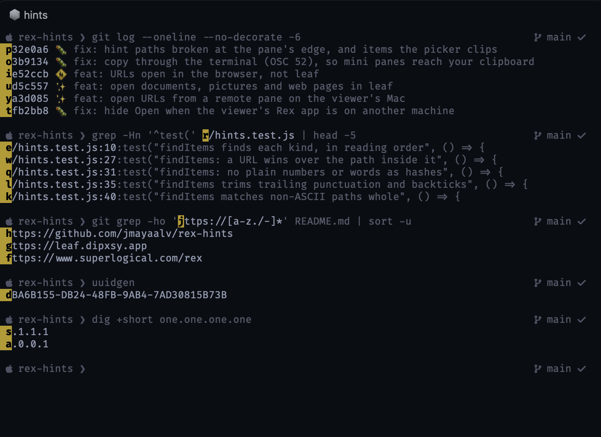
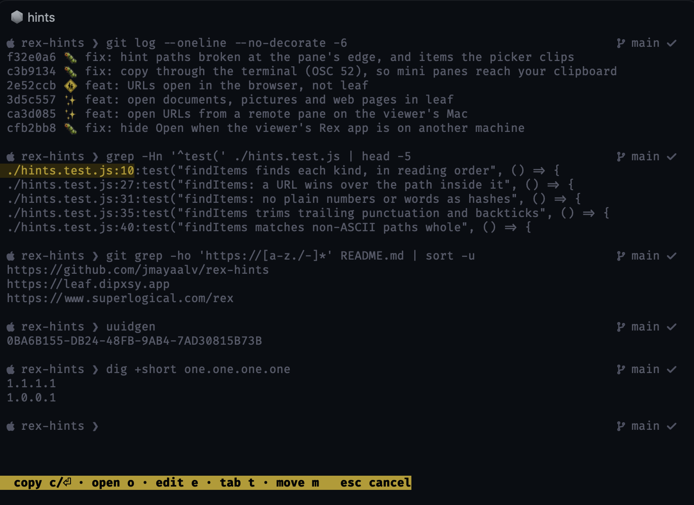
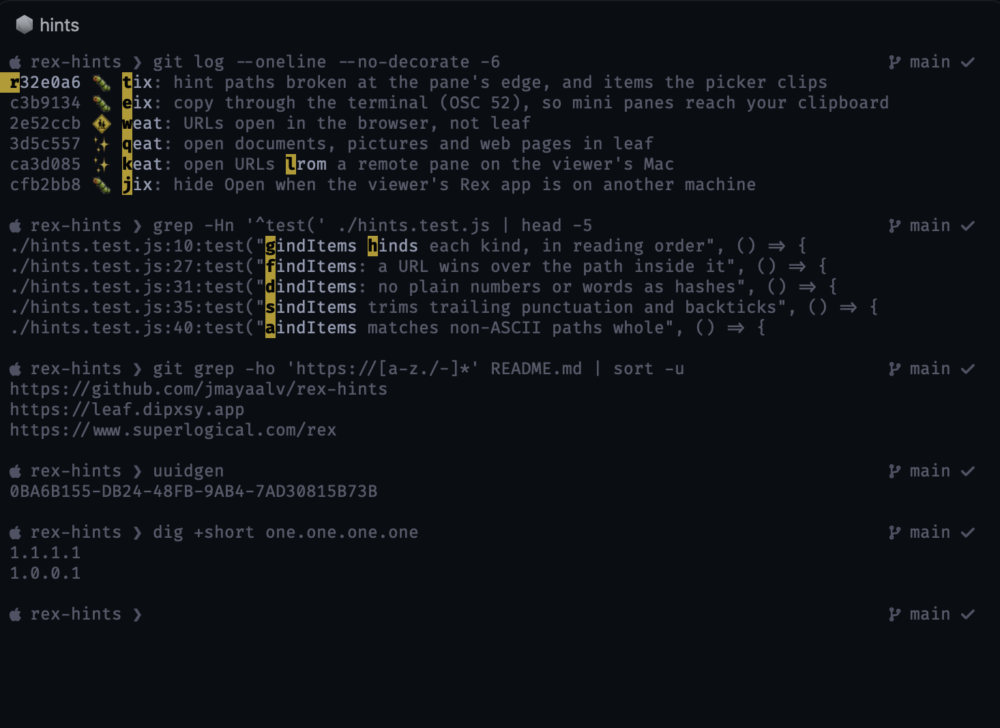

# rex-hints

Keyboard hints over a [Rex](https://www.superlogical.com/rex) pane, tmux-fingers and
ace-jump style. No mouse needed to grab or reach what's on screen.



- **Hints** (`super+shift+j`): every URL, file path (with `:LINE:COL`), git hash, UUID and
  IPv4 address on the focused pane gets a one- or two-letter hint. Type the hint, then:
  `c` (or Enter) copy · `o` open (URLs in the browser; PDF, EPUB, Markdown and pictures in
  [leaf](https://leaf.dipxsy.app) when it's installed; the rest with `open`) ·
  `e` edit in a split on the right · `t` edit in a new tab (Emacs or vim, see below) ·
  `m` move (click there). The menu only offers what fits the item.
- **Jump** (`super+ctrl+j`): ace-jump. Type a word's first character (any case), then the
  hint on the word you want; the cursor goes there. One match jumps at once.

| After `e`: the menu for that path | Jump, after `f`: a hint on each word starting with f |
| --- | --- |
|  |  |

Escape cancels, Backspace takes back a letter. The picker is a floating pane laid exactly
over the source pane, showing its visible screen dimmed with the hints on top (plain text,
not the original colors). It reads only the tail of the pane's output, so a huge
scrollback still opens in about 300 ms.

## Needs

- Rex (tested with Preview 0.1.0 build 1853 on macOS) and node 20+ (built-ins only).
- An `open` command for Open (macOS has one). Copy goes through the terminal (OSC 52), so
  it lands on the clipboard of the machine running the Rex app.
- Optional: [leaf](https://leaf.dipxsy.app) on `PATH`. Open then reads documents and pictures
  in leaf, placed the way its Rex plugin does (at an idle prompt, or in a pane beside).
  URLs still go to the browser.
- Edit and tab run, in an interactive zsh, your `ec` when it has one (a function that opens
  files in a terminal Emacs, e.g. `ec() { emacsclient -t "$@"; }`, called as
  `ec +LINE:COL FILE`), or else vim. `setup{ editor = "nvim" }` picks another (a command,
  function or alias): vi, vim and nvim go to the line and column, emacs and emacsclient
  get `+LINE:COL`, anything else `+LINE`.
- Move and Jump send a mouse click, so they move the cursor in programs that take clicks
  (Emacs with `xterm-mouse-mode`, vim, most TUIs). A shell prompt takes no clicks, so
  there they press the arrow keys instead, for a target on the cursor's row (the command
  you're typing); elsewhere on a shell's screen they do nothing.

## Install

```sh
git clone https://github.com/jmayaalv/rex-hints ~/.config/rex/rex-hints
echo 'require("rex-hints").setup()' >> ~/.config/rex/init.lua
rex config reload
```

That binds Hints to `super+shift+j` and Jump to `super+ctrl+j`. For other keys use
`setup{ hints = "…", jump = "…" }`, with `false` to leave one unbound; `rex keymap` shows
what's bound. `editor = "…"` sets the editor (see Needs). A clone somewhere else loads with `dofile("/path/to/rex-hints/init.lua").setup()`.
To update: `git -C ~/.config/rex/rex-hints pull`, then `rex config reload`.

It also defines `open_url`, which the picker on another Rex host calls to open a URL on
the machine running the Rex app.

## Tests

```sh
node --test hints.test.js
```

## Known limits

- A URL that wraps onto the next row becomes two items. A path broken at the pane's edge
  (Claude Code breaks long ones itself) is joined with the run that starts the next row,
  so a path that ends exactly at the edge also takes the next row's first word.
- Only the visible screen is hinted, not scrollback; a pane scrolled up in the app shows
  its live screen. The picker is a row shorter than its pane (a floating layer's frame
  takes one): it drops a blank row at the bottom first, so when the pane's last row holds
  text, its top row gets no hint.
- F1–F4 can type a hint letter; the menu row covers a picked item on the last row; hint
  letters are misdrawn over an item starting with a combining mark or a wide character;
  an emoji with VS16 (⚠️) counts as one cell, so Move after it lands one cell left.
- A pane on another Rex host runs the picker there (Rex runs a pane on its session's host).
  The machine running the Rex app sends it the script's code, so that host needs node 20+
  but not rex-hints. Its actions act on that host: Edit opens its files. Copy still lands on
  your clipboard (OSC 52).
  Open reads documents and pictures in leaf there when it's installed, sends http(s) URLs
  back to the machine running the Rex app through `open_url` (that host's `rex` must reach
  your local Rex server over Tailscale), and is hidden for other paths.

## License

MIT
